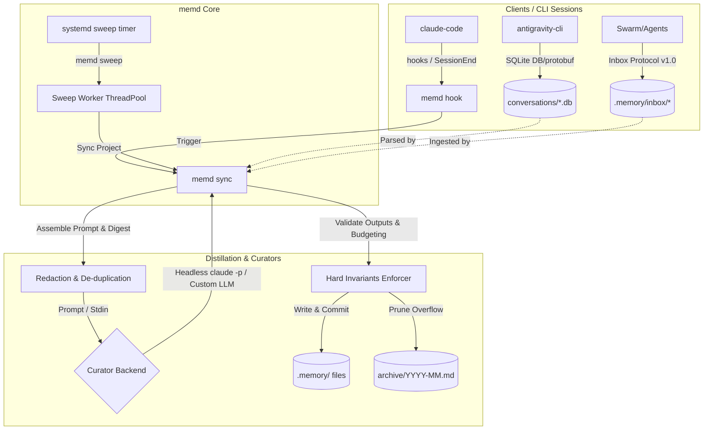

# memd — Agent-Driven Project Memory Curator

<p align="center">
  
</p>

[](https://github.com/lowcache/memd/actions/workflows/ci.yml)
[](https://pypi.org/project/memd/)
[](https://pypi.org/project/memd/)
[](LICENSE)
[](#nix-installation)

`memd` gives your AI coding tools a memory that survives between sessions. It runs quietly in the background, reads the session logs your CLIs leave behind (`claude-code`, `antigravity-cli`, custom agents), and boils them down into a few small, git-versioned markdown files under `./.memory/` — the stuff worth remembering, minus the noise.

---

## Why memd?

Every AI coding session ends the same way: the context window fills up, the session closes, and everything the model figured out — the port that service actually runs on, why you picked SQLite, the bug it hit last Tuesday — is gone. Next session it asks the same questions and steps on the same rakes.

`memd` fixes that by keeping a small set of memory files up to date automatically:
*   **Remembers what matters:** current system state, active decisions, and open todos, in plain markdown you can read yourself.
*   **Skips what doesn't:** conversational back-and-forth and tool spam get dropped; only durable facts survive.
*   **Works with a crowd:** a lock-safe inbox lets any agent, script, or human hand a note to the curator without stepping on anyone else.
*   **Keeps receipts:** memory changes are committed to git, so you can see how your project's context evolved over time.

---

## How It Works

Sessions end (or a timer fires), memd collects whatever is new — transcripts, databases, inbox notes — scrubs it for secrets, and hands it to a small "curator" model that applies surgical section-level updates to the memory files. Python code, not the model, gets the final say on what's allowed to change.



---

## The Four Memory Files

Everything lands in four markdown files under `./.memory/`:

| File | What's in it | House rules |
| :--- | :--- | :--- |
| `state.md` | What's true *right now*: ports, directory layout, running services, active workarounds. | Present tense only. When a fact goes stale it gets replaced — no history kept here. |
| `decisions.md` | What was decided, why, and what that rules out. | Each entry has to actually constrain future work, not just describe the past. |
| `todo.md` | What's still open: tasks, roadmap items, things to verify. | Finished or abandoned items move to the archive. |
| `mistakes.md` | What went wrong before, and how to not do it again. | Append-only. Each entry: symptom, root cause, and the rule that prevents a repeat. |

*Content that leaves the active files is moved to `./.memory/archive/YYYY-MM.md`, never deleted, and `memd recall` still finds it.*

---

## Teaching Your Agents to Use the Memory

Keeping the memory curated is only half the job. The models working in your codebase won't read `.memory/` unless something tells them it exists and how to behave around it. The rules boil down to three:

1.  **Read first.** Check `state.md`, `decisions.md`, `mistakes.md`, and `todo.md` (or run `memd brief` for a short digest) before doing real work. To look up something specific, including what has been archived, run `memd recall <terms>`.
2.  **Don't edit the memory files.** The curator owns them and rewrites them on every pass — hand-edits just get overwritten.
3.  **Send new facts through the inbox.** `memd note -m "..."`, or drop a file in `.memory/inbox/`. One fact per note.

You don't have to write those instructions yourself. `memd init` puts them in the project root, under the name your tools actually read — no assistant is assumed:

| File | Read by | Written |
| :--- | :--- | :--- |
| `AGENTS.md` | Codex, Cursor, Zed, Gemini CLI, and anything else on the [agents.md](https://agents.md) standard | always — it's the cross-tool standard |
| `CLAUDE.md` | Claude Code | if `.claude/` exists here or in your home directory |
| `GEMINI.md` | Gemini CLI / antigravity-cli | if `.gemini/` exists |

So a project picks up instructions for the tools you actually use, not for every assistant that exists. **Your own files keep their content.** If a `CLAUDE.md` (or `AGENTS.md`, `GEMINI.md`) already exists, memd copies it to `CLAUDE.md.bak` beside it and appends the memd section to the end; it never overwrites an existing backup. A file that already has the section is left alone, so running `memd init` again changes nothing.

For two conventions memd doesn't write — GitHub Copilot's `.github/copilot-instructions.md` and Cursor's `.cursor/rules/memd.mdc` — plus longer versions of all of the above, see [`contrib/agents/`](contrib/agents/).

### What's agent-agnostic (and what isn't yet)

The core of memd doesn't care which agent or model you use: the memory files are plain markdown, the inbox accepts notes from anything that can write a file, `memd brief` prints to stdout for any tool to consume, and the `curator_cmd` config key lets any LLM command do the distilling. The parts that are currently tool-specific:

*   **Automatic transcript ingestion** understands `claude-code` session logs and `antigravity-cli` databases natively, and digests *any other* CLI's session logs via content sniffing and a best-effort text fallback (common `user:`/`assistant:` markers become turns) — point `extra_sources` at whatever a tool writes, or route facts through the inbox instead.
*   **Lifecycle hooks** (`memd install-hooks`, session-start brief injection) exist only for `claude-code`. Every other tool relies on the periodic sweep timer instead: slower cadence, same result.
*   **The default curator is the `claude` CLI**, and the default `model_small`/`model_large` names (both `sonnet`) assume it. Set `curator_cmd` to distill with a local model, another vendor's CLI, or anything else — [`contrib/curators/`](contrib/curators/) has ready-made wrappers and the backend contract, so you can run memd with no Anthropic dependency at all.

---

## Guardrails Enforced by Code (Not the LLM)

The curator model is useful but not trusted. The rules that keep the store *structurally* intact live in plain Python, so a confused or misled model can't corrupt, truncate, or silently rewrite your memory:

1.  **Frontmatter required:** Every memory file must carry valid YAML frontmatter (`type`, `project`, `last_updated`, `status`), or the write is rejected.
2.  **Mistakes are forever:** `mistakes.md` is append-only. The curator can add entries but never edit or delete old ones.
3.  **Shrink guard:** A distill that would delete more than 60% of a file gets rejected — unless the removed sections were explicitly moved to the archive.
4.  **Size budgets:** Each file has a character cap (set in `config.json`). `mistakes.md` overflow is moved to the archive by code, oldest entries first. For `state.md`, `decisions.md` and `todo.md`, age says nothing about whether something is still true, so code never archives them on its own: an over-budget file gets an `OVER BUDGET` notice in the curator prompt with its oldest dated sections shown as candidates, the curator archives what is superseded or done, and `memd status` flags the file until it is back under budget.
5.  **No races:** Per-project file locking (`flock`) keeps concurrent sweeps, hooks, and agents from corrupting each other's writes.
6.  **Nothing skipped:** memd tracks how far it has read into each transcript and database, and only advances that marker after a successful distill and write — a failed run just gets retried from the same spot.

What these rules do *not* do is judge the meaning of what the curator writes — the file bodies are free-form prose. Since memory is distilled from your sessions and fed back into later ones, content you worked on can influence what gets remembered. memd bounds this (memory is plain markdown under its own git history, so it's readable, diffable, and revertable) and the session brief labels memory as reference notes rather than instructions, but it's a real property of the design. [`SECURITY.md`](SECURITY.md) has the threat model and what to do about it.

---

## Where the Raw Material Comes From

`memd` pulls from several sources before each distill:

### 1. `claude-code` Hooks
`memd` plugs into the `claude-code` CLI through lifecycle hooks in `~/.claude/settings.json` (wired up for you by `memd install-hooks`):
*   **Session start:** the memory brief gets injected into the assistant's starting context, so it begins the session already knowing the project.
*   **Session end / pre-compact:** a background `memd sync` digests the transcript of the session that just finished.

### 2. `antigravity-cli` Database Parsing
For `antigravity-cli`, `memd` reads the SQLite conversation databases in `~/.gemini/antigravity-cli/conversations/*.db` directly:
*   Pulls out the useful steps — user inputs, assistant responses, tool actions, errors.
*   Figures out which project a conversation belongs to by counting workspace-path mentions in the payloads (index kept in `~/.local/state/memd/ag_index.json`).

### 3. The Inbox Protocol (v1.0)
The inbox is how everything else — another agent, an MCP tool, a CI script, you with a text editor — hands a fact to the curator without touching the memory files directly. Drop a markdown note in the inbox; the next sweep folds it into memory and deletes the note.

*   **Project Inbox:** `<project-root>/.memory/inbox/` (feeds local project files)
*   **Global Inbox:** `<global_root>/.memory/inbox/` (default `~/.memory/inbox/`, feeds system-wide/cross-project files)

#### Rules for Writers
The inbox has many writers and one reader that deletes what it consumes, so a sloppy writer can lose data for everyone. Every writer must publish atomically:
1.  **Stage Outside the Inbox:** Write the markdown note to a temporary file in the *parent* `.memory/` directory (e.g. `.remember-*.tmp`).
2.  **fsync the File:** Durably sync the data to disk (`flush` + `fsync`).
3.  **Atomic Publish:** Publish to the `inbox/` directory via `rename(2)` or `link(2)` (`os.replace` or `os.link`).
4.  **fsync the Inbox Directory:** Ensure the parent directory structure is updated.
5.  **Collision-Proof Names:** Name files using microsecond-resolution timestamp + PID (e.g., `20260711T123000123456-9876.md`).
6.  **Write-Once:** Never modify or reuse a published note.

For complete writer/reader guidelines, see [INBOX-PROTOCOL.md](INBOX-PROTOCOL.md).

---

## How memd Uses Your Model

The backend transport, prompt, output schema and guards are defined in [docs/curator-protocol.md](docs/curator-protocol.md).

Distilling means sending session content to an LLM, so it's worth being precise about what goes where and what it costs.

**What gets sent.** Whatever is new in your transcripts since the last run — as chronologically ordered, timestamped session spans — capped at `digest_cap_chars` (60,000 by default), plus the current memory files (`mistakes.md` only as a heading index; it is append-only). Credentials are scrubbed first — 13 patterns, [detailed below](#built-in-credential-redaction) — but that's shape-matching, not a guarantee.

**Where it goes.** To whatever `curator_cmd` points at. Out of the box that's the `claude` CLI, which means your session content reaches Anthropic's API. Point it at a local model and nothing leaves the machine; [`contrib/curators/`](contrib/curators/) has a verified ollama wrapper and the backend contract. `memd status` always prints the backend in use, so you never have to infer it:

```
$ memd status
curator      : claude (headless)  [models: sonnet/sonnet]  — sends session content to the Anthropic API
```

**What it costs.** A distill runs when a session ends, and the sweep timer checks every 30 minutes for projects with new content. Most sweeps do nothing — a project is skipped unless it has unread transcript content or an inbox note, and transcripts touched in the last `quiet_seconds` (10 minutes) are left alone so an active session isn't digested mid-flight. When a distill does run it's one call, on `model_small` unless the digest exceeds `escalate_chars` (15,000), which promotes it to `model_large`. Digests under `min_digest_chars` (3,000) wait until more content arrives or the oldest of it is a day old, and the default `claude` call runs without tools, MCP servers, plugins or your CLAUDE.md, so you pay for memd's prompt and nothing else. `memd status` shows what distills have cost.

Both default to `sonnet`, which is a deliberate choice: curation quality *is* the product, and a weak default model is indistinguishable from a weak tool to anyone trying memd for the first time. It costs more than the cheapest option. To spend less, set `model_small` to `haiku` — routine distills drop to it while large backlogs still escalate. To spend nothing, use a local backend.

**What memd never does.** No network calls of its own, no telemetry, no phone-home. It reads session transcripts, inbox notes, and any `extra_sources` you configure — not your source code. It never executes anything from a transcript or from curator output. See [SECURITY.md](SECURITY.md).

**When ingestion breaks, it says so.** memd reads formats that belong to other tools — `claude-code`'s session logs, `antigravity-cli`'s databases — and those can change without notice. Parsing is deliberately forgiving, so a change doesn't crash anything; unknown third-party formats simply degrade to the text fallback and keep working. The surviving blindspot is claude-shaped JSONL whose entries stop yielding lines: session content read, nothing usable extracted. `memd status` reports exactly that instead of leaving you to notice months later that memory went stale.

```
! ingestion  : 9720 bytes read since 2026-07-30T06:11:27, nothing usable extracted.
               memd may not recognise this tool's transcript format any more. Nothing
               is lost — the backlog replays once parsing works.
```

Nothing is lost when this happens: read cursors only advance after a successful distill, so the unread content simply replays once parsing works again.

### 4. Extra Custom Sources
Additional transcript sources (any text or JSONL log another CLI writes — role tags like `user:`/`assistant:` are detected heuristically) can be registered per-project under the `projects.<path>.extra_sources` array in `config.json`.

---

## Configuration (`config.json`)

Configuration is stored in `$XDG_CONFIG_HOME/memd/config.json` (defaults to `~/.config/memd/config.json`).

### Key Reference & Defaults

Use `model_small` to select the routine model and `curator_cmd` to select a backend.
The complete defaults and behavior are in [docs/configuration.md](docs/configuration.md).

#### Default File Budgets
`budgets` sets per-file body character budgets; the configuration reference describes defaults and overflow behavior.

---

## Built-In Credential Redaction

Session transcripts have a bad habit of containing API keys. Before anything reaches the curator model, `memd` scrubs it with a set of regex filters, so a token that leaked into a transcript doesn't leak again into a prompt (or into a git-committed memory file).

13 rules are built in:
*   `google_oauth` (Google OAuth2 tokens, `ya29.` prefix)
*   `github_pat` (Classic and fine-grained GitHub tokens)
*   `anthropic_key` (Anthropic API keys, `sk-ant-` prefix)
*   `openai_key` (OpenAI API keys, `sk-` / `sk-proj-` prefix)
*   `aws_access` (AWS Access Key IDs, `AKIA` prefix)
*   `slack_token` (Slack bot/user/workspace tokens, `xox` prefix)
*   `gitlab_token` (GitLab PATs, `glpat-` prefix)
*   `npm_token` (npm access tokens, `npm_` prefix)
*   `jwt` (JSON Web Tokens starting with `eyJ`)
*   `json_token_field` (JSON keys containing `access_token`, `refresh_token`, etc.)
*   `bearer_header` (HTTP Authorization headers with Bearer tokens)
*   `env_credential` (UPPERCASE credentials assigned in `.env` or shell exports)
*   `ssh_private_key` (PEM blocks starting with `-----BEGIN ... PRIVATE KEY-----`)

> [!NOTE]
> Azure storage/service keys do not have a distinct prefix and cannot be reliably matched without high false-positive rates. Use `REDACT_EXTRA_PATTERNS` to configure rules matching your specific Azure keys if needed.

---

## CLI Command Quick Reference

- `memd init [path]`: provision memory and register a project.
- `memd sync`: distill new session content and inbox notes.
- `memd sweep`: catch up projects and maintain memory.
- `memd status`: show the backend, registry and ingestion status.
- `memd install-hooks`: install lifecycle hooks.
- `memd brief [path]`: print a session-start brief.
- `memd recall <terms>`: search active and archived memory.
- `memd hook <event>`: handle a lifecycle event.
- `memd note`: publish a curator inbox note.
- `memd exclude <path>`: exclude a path from automatic discovery.

See [docs/cli.md](docs/cli.md) for arguments, output and exit codes.

---

## What memd Writes, and When

memd draws a hard line between what it needs in order to work and what changes your project. Automatic behaviour stays on its own side of that line.

**Automatically** — when the session-start hook or the sweep notices a git repo you're working in — memd creates `./.memory/` and registers the project. That directory is its own git repository, so memory history never enters your project's history, and the ignore rule goes in `.git/info/exclude`, which is local to your clone and untracked. Nothing you have committed is modified. Turn discovery off entirely with `"auto_scaffold": false`, or skip individual repos with `memd exclude <path>`.

**Only when you run `memd init`** does memd touch the project itself: it adds `.memory/` to your tracked `.gitignore` (so the rule is shared with collaborators) and writes the memory contract into the project root. `AGENTS.md` is always written, since it's the cross-tool standard; `CLAUDE.md` and `GEMINI.md` appear only if you actually use those tools. **Existing files of those names are appended to, not replaced** — the original is saved as `<name>.bak` first.

Everything memd generates is plain markdown under git, so anything it got wrong is visible in a diff and revertable.

**Platform:** POSIX only (`flock`-based locking). Linux is the tested platform; macOS is expected to work but is untested, and Windows is not supported.

---

## Installation

### Requirements

*   **Linux**, Python **3.10+** (standard library only, zero runtime dependencies), and `git` on `PATH`.
*   **A curator backend** — the piece that actually runs the distillation LLM. One of:
    *   the [`claude` CLI](https://docs.anthropic.com/en/docs/claude-code) installed and authenticated (the default; see the `claude_bin` config key), **or**
    *   any command you configure via `curator_cmd`: it receives the prompt on stdin and must print one JSON object (fences/prose tolerated). This is how you run memd against a local Ollama model, another vendor's CLI, or anything else — see [contrib/curators/](contrib/curators/) for working wrappers and the full contract.

Without a working backend, everything except distillation still works — `init`, `brief`, `note`, `status` — and `memd sync` exits `3` while preserving the backlog, which replays automatically once a backend is available.

### pip Installation

```bash
# From PyPI
pip install memd

# With pipx (recommended for CLI tools — isolated, no system-Python friction)
pipx install memd

# Directly from the repository, no PyPI needed
pip install git+https://github.com/lowcache/memd

# From a local clone (add -e for editable/development mode)
pip install .
```

> **PEP 668 note:** distributions that mark the system Python as externally managed (NixOS, Debian 12+, Arch, Fedora 38+) reject bare `pip install` outside a virtual environment. Use `pipx`, or a venv: `python3 -m venv ~/.venvs/memd && ~/.venvs/memd/bin/pip install memd`.

### Nix Installation

`memd` is packaged as a Nix flake. You can run or install it directly:

```bash
# Run ad-hoc from the flake
nix run github:lowcache/memd -- status

# Install to user profile
nix profile install github:lowcache/memd
```

#### Declarative Setup via Home Manager
Import the module and enable the periodic sweep timer:

```nix
{ inputs, pkgs, ... }: {
  imports = [ inputs.memd.homeManagerModules.default ];

  services.memd = {
    enable = true;
    installClaudeHooks = true; # Idempotently configure ~/.claude/settings.json hooks

    sweep = {
      enable = true;            # Periodically execute `memd sweep`
      interval = "30min";       # Timer interval (default: "30min")
      onBoot = "5min";          # Delay after boot before running the first sweep (default: "5min")
      randomizedDelay = "2min"; # Randomized delay jitter (default: "2min")
    };
  };
}
```

#### Standalone systemd User Service & Timer

For non-Nix environments, a standalone systemd user service and timer can be set up using files in the `contrib/` directory:

```bash
# Copy units to the user systemd directory
cp contrib/memd-sweep.* ~/.config/systemd/user/

# Reload the systemd user manager
systemctl --user daemon-reload

# Enable and start the timer
systemctl --user enable --now memd-sweep.timer
```

Refer to [contrib/README.md](contrib/README.md) for detailed customization and uninstallation instructions.

### Manual Installation (no pip, no Nix)

`memd` is compatible with **Python 3.10 to 3.14** and uses standard library packages exclusively, so a plain clone runs as-is:

```bash
git clone https://github.com/lowcache/memd && cd memd
./memd.py --help
```

Symlink the shim onto your `PATH` for a live-updating install: `ln -s "$PWD/memd.py" ~/.local/bin/memd`.

---

## Testing & Verification

387 automated tests cover the parts that would hurt if they broke: XDG isolation, cursors, redaction, database parsing, atomic inbox publishing (including an 8-writer concurrency stress test), retry policies, curator output parsing (including the malformed JSON small models produce), brief budgeting, memory-repo decoupling + worktree sharing, one-store-one-project identity across bind mounts, silent-ingestion-breakage detection, and curation quality. Verified on Python 3.10 through 3.14.

To run tests in a Nix-isolated environment:
```bash
nix flake check
```

Or run via `pytest` locally:
```bash
python -m pytest tests/ -q
```

The curation-quality eval replays scripted sessions (`eval/scenarios/*.json`) through the real pipeline and a real curator, then checks the resulting memory with regex probes. It spends model tokens. Each scenario runs `--samples` times; a scenario passes only if every sample does:
```bash
python eval/run.py --samples 3 --jobs 6 --config '{"model_small": "haiku"}'
```

---

## Changelog

- **0.3.0**: Each project's `.memory/` now gets its own standalone Git repository, decoupling memory history from code branches. Linked Git worktrees automatically share one physical `.memory` store via symlinks (never overwriting unsaved memory), and a migration helper untracks `.memory` from the parent repo on init.
